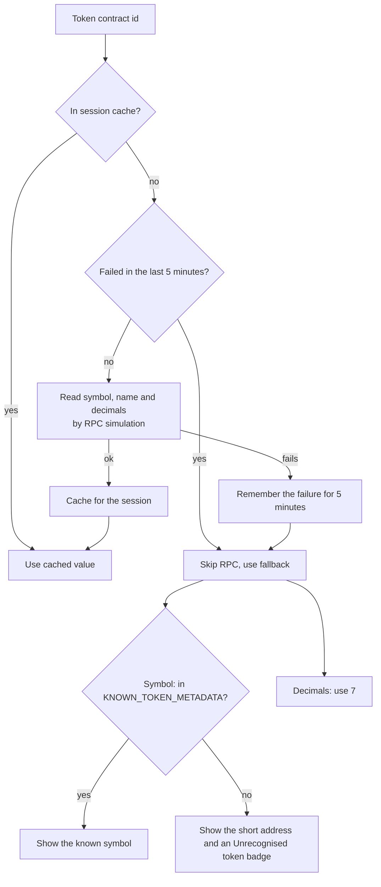

# Token symbols and decimals

The app shows a symbol (such as XLM) and formats amounts using the token's
decimals. Both are read from the token contract, with fallbacks when the read
fails. The code lives in `lib/token-metadata.ts` (symbol and name) and
`lib/token-decimals.ts` (decimals).

## How a token is resolved



## Sources

| Value | Source | Where |
| --- | --- | --- |
| `symbol()` | The token contract, read by a read-only simulation | `readTokenMetadata` |
| `name()` | The token contract. If it fails or is empty, the symbol is used as the name | `readTokenMetadata` |
| `decimals()` | The token contract, an integer from 0 to 255 | `readTokenDecimals` |

## Caching

- Resolved values are kept in memory for the browser session. A page reload
  clears them.
- Concurrent lookups for the same token share one request.
- A failed lookup is remembered for 5 minutes (`FAILED_TOKEN_METADATA_TTL_MS`
  and `FAILED_TOKEN_DECIMALS_TTL_MS`), so a broken token does not trigger an
  RPC call on every render. Passing `forceRefresh` skips the remembered failure.

## Fallbacks and their effect on amounts

| Situation | Fallback | Effect on what the user sees |
| --- | --- | --- |
| `symbol()` fails and the token is in `KNOWN_TOKEN_METADATA` | The known symbol and name | The symbol is shown as normal. |
| `symbol()` fails and the token is unknown | None | The short address with an "Unrecognised token" badge. Amounts have no symbol suffix, and rates read "tokens/day". |
| `name()` fails or is empty | The symbol | The symbol is shown as the name. |
| `decimals()` has not resolved yet or fails | 7 decimals | Amounts are formatted as if the token had 7 decimals. A token with other decimals shows a wrong value until its decimals resolve. |
| `decimals()` fails in the create form | 7 decimals | The form shows "Could not read decimals from token contract. Defaulting to 7 decimals." |

Known tokens only provide a symbol and name. They never supply decimals.

## Adding a known token

Add an entry to `KNOWN_TOKEN_METADATA` in `lib/token-metadata.ts`, keyed by the
token's contract id:

```ts
export const KNOWN_TOKEN_METADATA: Record<string, TokenMetadata> = {
  // ...existing entries
  CEXAMPLECONTRACTIDEXAMPLECONTRACTIDEXAMPLECONTRACTID: {
    name: "Example Token",
    symbol: "EXT",
  },
};
```

The entry is only used when the contract cannot be read, or before the first
read finishes, so it should match what the contract returns.
