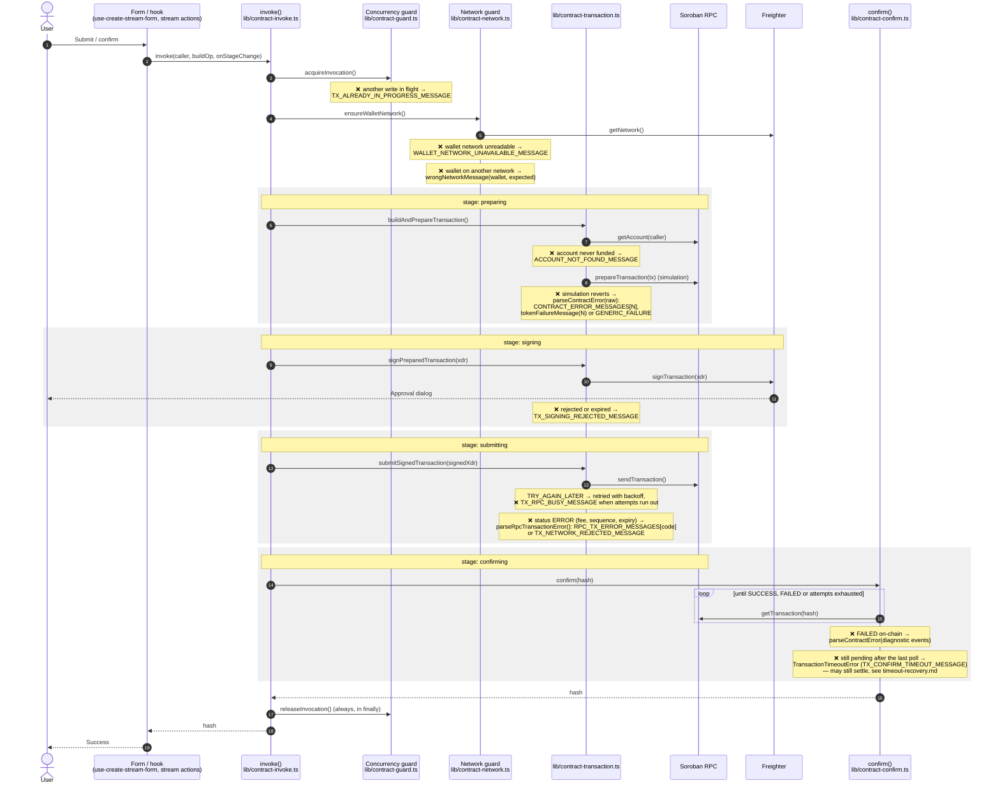

# Transaction write path

Every on-chain write (create, withdraw, cancel) runs through `invoke()` in
`lib/contract-invoke.ts`. This diagram follows one transaction from the form
to confirmation and marks, with ❌, where each kind of failure is raised and
the message the user sees. The stage names (`preparing`, `signing`,
`submitting`, `confirming`) are the `TxStage` values shown by
`components/transaction-progress.tsx`.

## Failure summary

| Step | Raised in | Message |
| --- | --- | --- |
| Concurrency guard | `lib/contract-invoke.ts` | `TX_ALREADY_IN_PROGRESS_MESSAGE` |
| Network guard (unreadable) | `lib/contract-network.ts` | `WALLET_NETWORK_UNAVAILABLE_MESSAGE` |
| Network guard (mismatch) | `lib/contract-network.ts` | `wrongNetworkMessage(...)` |
| Account lookup | `lib/contract-transaction.ts` | `ACCOUNT_NOT_FOUND_MESSAGE` |
| Simulation | `lib/contract-transaction.ts` | `parseContractError` → contract/token/generic message |
| Signing | `lib/contract-transaction.ts` | `TX_SIGNING_REJECTED_MESSAGE` |
| Submission (busy) | `lib/contract-transaction.ts` | `TX_RPC_BUSY_MESSAGE` |
| Submission (rejected) | `lib/contract-transaction.ts` | `parseRpcTransactionError` → `RPC_TX_ERROR_MESSAGES` or `TX_NETWORK_REJECTED_MESSAGE` |
| Confirmation (failed) | `lib/contract-confirm.ts` | `parseContractError` → contract/token/generic message |
| Confirmation (timeout) | `lib/contract-confirm.ts` | `TransactionTimeoutError` / `TX_CONFIRM_TIMEOUT_MESSAGE` |

The message strings live in `lib/contract-messages.ts` and
`lib/contract-errors.ts`. How each one is shown is described in
[api-error-handling.md](api-error-handling.md); recovering a timed-out
confirmation is covered in [timeout-recovery.md](timeout-recovery.md). To add
or change a contract error message, see
[adding-contract-error-messages.md](adding-contract-error-messages.md).

## Submission statuses

`sendTransaction` answers right away with a status. It does not wait for a
ledger, so a `PENDING` answer is not yet a success. The handling is in
`submitSignedTransaction()` in `lib/contract-transaction.ts`.

| Status | Meaning | What the app does | What the user sees |
| --- | --- | --- | --- |
| `PENDING` | The RPC accepted the transaction into its pool. | Returns the hash and moves to the confirming stage. | The progress indicator moves on to confirming. |
| `DUPLICATE` | The RPC already has this transaction, for example after a repeated send. | Treated like `PENDING`: returns the hash and moves to confirming. | Same as `PENDING`. |
| `TRY_AGAIN_LATER` | The RPC is busy and did not take the transaction. | Waits and sends the same signed transaction again, up to the attempt budget below. | Nothing until the attempts run out, then `TX_RPC_BUSY_MESSAGE` and the stream is not created or changed. |
| `ERROR` | The RPC rejected the transaction, for example a bad sequence number, low fee or expiry. | Does not retry. Reads the result code with `parseRpcTransactionError`. | A message from `RPC_TX_ERROR_MESSAGES` for a known code, otherwise `TX_NETWORK_REJECTED_MESSAGE`. |
| Any other value | Not expected from the RPC. | Does not retry. | `TX_NETWORK_REJECTED_MESSAGE`. |

## Retry and timeout budgets

| Budget | Value | Constant | Effect when it runs out |
| --- | --- | --- | --- |
| Submission attempts | 3 sends in total | `SUBMIT_MAX_ATTEMPTS` | The user sees `TX_RPC_BUSY_MESSAGE`. |
| Submission backoff | 500 ms, then 1000 ms between sends (doubles each time, no wait after the last) | `SUBMIT_RETRY_BASE_DELAY_MS` | None. About 1.5 seconds of waiting at most. |
| Confirmation polling | `getTransaction` every 1 second, 30 times (about 30 seconds) | `CONFIRM_POLL_INTERVAL_MS`, `CONFIRM_POLL_ATTEMPTS` | A `TransactionTimeoutError` with `TX_CONFIRM_TIMEOUT_MESSAGE`. The transaction may still settle. |

The constants are in `lib/contract-config.ts`. A timeout means the client stopped
waiting, not that the transaction failed. The hash is kept so the user can check
again without sending a second transaction. See
[timeout-recovery.md](timeout-recovery.md) for that recovery flow.
